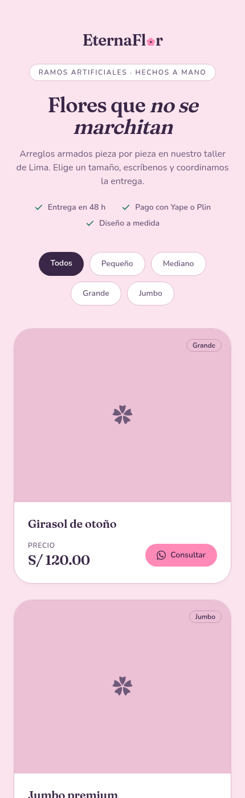
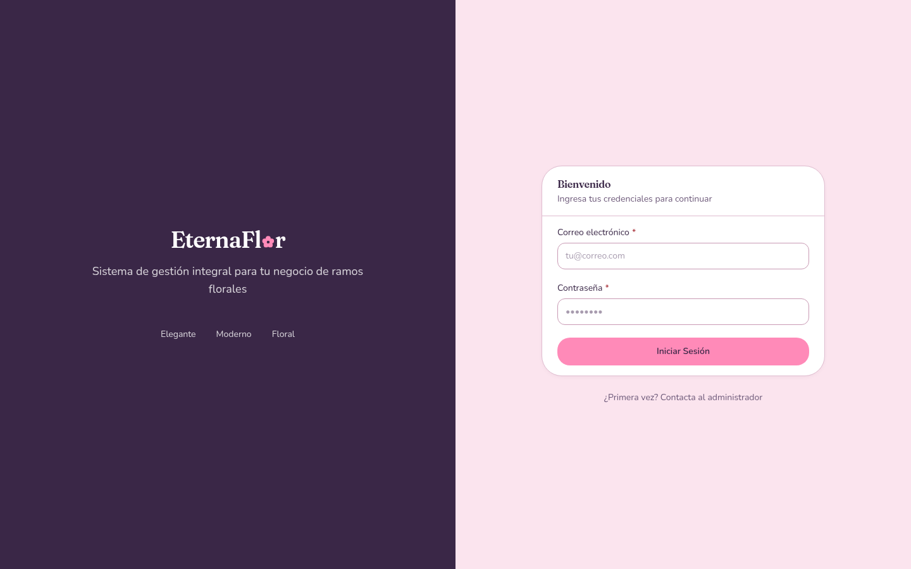

# EternaFlor

[](https://github.com/DDR144/eterna-flor/actions/workflows/ci.yml)

Sistema de gestión para un negocio de ramos florales: inventario de materias primas, ramos con receta y costo calculado, pedidos con descuento de stock, reportes de ventas y un catálogo público que se comparte por WhatsApp.

Es un proyecto personal: todo corre en planes gratuitos y el costo mensual de infraestructura es **$0**.

## Capturas

Las capturas se tomaron con datos de demostración (`pnpm run seed:demo`), no con el catálogo real del negocio.


<details>
<summary>Más capturas: móvil y acceso al panel</summary>

| Móvil | Acceso al panel |
|---|---|
|  |  |

</details>

## En producción

| Componente | Dirección | Plataforma |
|---|---|---|
| Web (catálogo + panel) | <https://eterna-flor.vercel.app> | Vercel, plan Hobby |
| API (backend) | <https://eternaflor-api.onrender.com> | Render, web service Free |
| Base de datos | PostgreSQL | Neon, plan Free |
| Fotos de ramos | CDN de Cloudinary | Cloudinary, plan Free |

La dirección correcta de la web lleva guion: `eterna-flor.vercel.app`. `eternaflor.vercel.app` (sin guion) es de otra persona.

El servicio de Render duerme a los 15 minutos sin tráfico, así que la primera visita del día tarda cerca de un minuto. El endpoint `GET /health` existe para mantenerlo despierto con un ping externo y **no** consulta la base de datos, a propósito: despertaría Neon y agotaría sus horas de cómputo del mes. Está explicado en `eterna-flor-back/src/health/health.controller.ts`.

## Estructura

Dos paquetes independientes, sin `package.json` en la raíz. Cada uno se instala por separado con `pnpm`.

```
eterna-flor-back/    NestJS 11 + Prisma 5 + PostgreSQL  (API REST, puerto 3001)
eterna-flor-front/   Next.js 16 + React 19 + Tailwind 4  (puerto 3000)
docs/                Operación, arquitectura y guía de uso
design/              Sistema visual implementado (tokens reales)
odd/tasks/           Registro de las features trabajadas con ODD
```

## Arrancar en local

Requisitos: Node 24 y pnpm 12 (ambos paquetes fijan la versión en `.node-version` y `packageManager`).

**1. Base de datos.** Necesitas un PostgreSQL local. Copia `eterna-flor-back/.env.example` a `eterna-flor-back/.env` y apunta `DATABASE_URL` y `DIRECT_URL` a ese PostgreSQL local con `sslmode=disable`. La lista completa de variables está en el mismo `.env.example`; la única obligatoria para arrancar la API es `JWT_SECRET`.

**2. Backend.**

```bash
cd eterna-flor-back
pnpm install
pnpm exec prisma generate
pnpm exec prisma migrate dev
pnpm run seed        # opcional: datos de prueba + usuario admin@eternaflor.local / local1234
pnpm run seed:demo   # opcional: catálogo de demostración presentable (vacía la base local)
pnpm run start:dev   # http://localhost:3001
```

**3. Frontend.**

```bash
cd eterna-flor-front
pnpm install
pnpm dev             # http://localhost:3000
```

El frontend habla con `NEXT_PUBLIC_API_URL` y, si no está definida, cae a `http://localhost:3001`.

> El seed y los tests e2e se niegan a correr si `DATABASE_URL` no apunta a `localhost`, `127.0.0.1` o `::1` (guard en `eterna-flor-back/src/common/local-database.ts`). Ambos borran datos: nunca deben apuntar a Neon.

## Verificación

```bash
cd eterna-flor-back
pnpm run lint        # eslint + prettier --fix
pnpm run test        # unitarios (src/**/*.spec.ts)
pnpm run test:e2e    # requiere una base local

cd eterna-flor-front
pnpm lint
pnpm build
```

Corre `pnpm run lint` **antes** de `pnpm run test`: el proyecto no encadena uno con otro.

## Documentación

| Documento | Para qué |
|---|---|
| [`docs/estado-del-proyecto.md`](docs/estado-del-proyecto.md) | Estado vivo, variables de entorno, operación, trampas conocidas. **Empieza por aquí** para retomar el proyecto. |
| [`docs/architecture.md`](docs/architecture.md) | Arquitectura actual: componentes, módulos, modelo de datos, despliegue y decisiones retiradas. |
| [`docs/guia-rapida.md`](docs/guia-rapida.md) | Guía de uso del sistema para la dueña del negocio. |
| [`DESIGN.md`](DESIGN.md) | Intención del sistema visual "Pastel Candy". |
| [`design/system.md`](design/system.md) | Los tokens y componentes tal como están implementados. |
| [`AGENTS.md`](AGENTS.md) | Comandos y convenciones para agentes que trabajen en el repositorio. |

## Desplegar

`git push origin main`. Render y Vercel redespliegan solos a partir de `main`. Las migraciones de base de datos se aplican a mano, nunca en el arranque. El procedimiento completo está en `docs/estado-del-proyecto.md`.

## Licencia

MIT. Puedes leer el código, aprender de él y reutilizarlo citando la autoría. El nombre del negocio, sus datos y sus fotografías no se incluyen en esa cesión. Ver [`LICENSE`](LICENSE).
