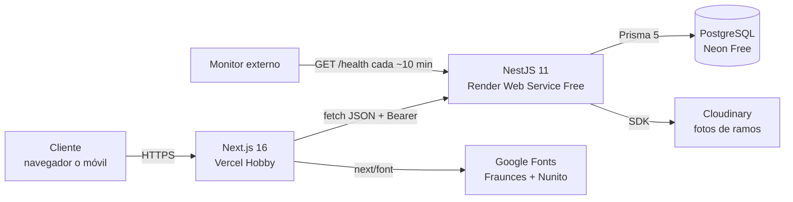

# Arquitectura de EternaFlor

Este documento describe el sistema **tal como está construido y desplegado hoy**. La documentación anterior (`docs/architecture/`, con sus ADR-001 a ADR-006) describía una arquitectura MySQL en Railway que nunca se desplegó; al final hay una sección de decisiones retiradas que deja constancia de qué se abandonó y por qué.

---

## 1. Vista general

Dos despliegues independientes que hablan por API REST JSON, más dos servicios gestionados.



- El frontend renderiza el catálogo en el servidor (SSR) y las pantallas del panel en el cliente.
- La API es stateless: no guarda sesiones, solo verifica el JWT en cada petición.
- Las imágenes no pasan por la API en lectura: `fotoUrl` apunta al CDN de Cloudinary.

## 2. Frontend — `eterna-flor-front/`

| Aspecto | Valor |
|---|---|
| Framework | Next.js 16.2.4 (App Router) + React 19.2.4 |
| Estilos | Tailwind CSS 4 vía `@tailwindcss/postcss`; tokens en el bloque `@theme` de `app/globals.css` |
| Tipografía | Fraunces (display) + Nunito (cuerpo), cargadas con `next/font/google` en `app/layout.tsx` |
| Despliegue | Vercel, plan Hobby, auto-deploy desde `main` |
| Configuración | `NEXT_PUBLIC_API_URL`; si falta, cae a `http://localhost:3001` (`lib/api.ts`) |

Rutas:

| Ruta | Qué es |
|---|---|
| `/` | Redirección al panel o al login según haya sesión |
| `/login` | Acceso de la administradora |
| `/catalogo` | Catálogo público, sin registro; renderizado en el servidor |
| `/admin` | Panel: inicio |
| `/admin/ramos` | Ramos con receta, costo calculado y stock |
| `/admin/materias-primas` | Insumos, stock y alertas |
| `/admin/pedidos` | Pedidos agrupados por fecha de entrega |
| `/admin/reportes` | Resumen de ventas, margen, más vendidos y exportación CSV |

Capa compartida:

- `components/ui/` — `Button`, `Card` (+ `CardHeader`/`CardBody`/`CardFooter`), `Badge`, `Field`/`Input`/`Select`/`Textarea`, `EmptyState`, `Spinner`, `Icon`.
- `lib/api.ts` — cliente HTTP, token y manejo de errores.
- `lib/auth-context.tsx` — estado de sesión del panel.
- `lib/format.ts` — `money`, `percent`, `shortDate` en `es-PE`.
- `lib/tamanos.ts` — traducción entre la etiqueta con acento que ve la clienta y el miembro del enum que devuelve la API.

## 3. Backend — `eterna-flor-back/`

NestJS 11 + Prisma 5 sobre Express. Puerto `3001` en local; en Render lo inyecta la plataforma.

Módulos en `src/`:

| Módulo | Endpoints | Acceso |
|---|---|---|
| `auth` | `POST /auth/register`, `POST /auth/login`, `POST /auth/logout`, `GET /auth/profile` | público con rate limit (register y login); profile con JWT |
| `catalogo` | `GET /catalogo?tamano=` | público |
| `materias-primas` | `GET /materias-primas`, `GET /alertas`, `GET /:id`, `POST`, `PATCH /:id`, `PATCH /:id/stock`, `DELETE /:id` | JWT |
| `ramos` | `GET /ramos`, `GET /alertas`, `GET /:id`, `POST`, `PATCH /:id`, `DELETE /:id` | JWT |
| `pedidos` | `GET /pedidos`, `GET /pendientes`, `GET /:id`, `POST`, `PATCH /:id`, `DELETE /:id` | JWT |
| `reportes` | `GET /resumen`, `GET /pendientes`, `GET /mas-vendidos`, `GET /exportar` | JWT |
| `health` | `GET /health` | público |

`common/` contiene lo transversal:

| Pieza | Qué hace |
|---|---|
| `guards/jwt-auth.guard.ts` | Exige un JWT válido en las rutas protegidas |
| `filters/prisma-exception.filter.ts` | Traduce errores de Prisma a códigos HTTP correctos |
| `services/cloudinary.service.ts` | Subida de fotos de ramos |
| `enum-label.ts` | Traduce etiquetas acentuadas (`Pequeño`, `En preparación`) a miembros del enum |
| `local-database.ts` | Guard que impide que el seed y los e2e corran contra una base remota |
| `decorators/` | Decoradores propios (usuario actual) |

Convenciones globales, en `src/main.ts`: `ValidationPipe` con `whitelist`, `forbidNonWhitelisted` y `transform`; CORS con origen único `FRONTEND_URL` y `credentials: true`; rate limit global de 5 peticiones por minuto.

## 4. Autenticación (contrato real)

1. `POST /auth/register` está **cerrado**: solo crea el primer usuario. Si ya existe uno, responde error; la comprobación se hace en una transacción serializable para que dos peticiones simultáneas no creen dos administradoras.
2. `POST /auth/login` valida con bcrypt (12 rondas) y responde con el token en el cuerpo **y** en una cookie. La cookie es `secure` cuando `NODE_ENV === 'production'`.
3. El frontend guarda el token en `localStorage` (`lib/api.ts`) y lo envía en cada petición como `Authorization: Bearer <token>`. La cookie es un extra, no el mecanismo principal.
4. El JWT expira a los **7 días** (`src/auth/auth.module.ts`).
5. `JWT_SECRET` es obligatorio: `getOrThrow` impide arrancar sin él.

## 5. Modelo de datos

PostgreSQL, schema en `eterna-flor-back/prisma/schema.prisma`.

```mermaid
erDiagram
    USUARIO { int id PK; string email; string password_hash; datetime created_at }
    RAMO {
        int id PK
        string nombre
        enum tamano "Pequeno|Mediano|Grande|Jumbo"
        string foto_url
        decimal precio_venta
        decimal costo_calculado
        int stock
        boolean activo
    }
    MATERIA_PRIMA {
        int id PK
        string nombre
        string unidad
        decimal stock_actual
        decimal costo_unitario
        int stock_minimo_alerta
    }
    RECETA { int id PK; int ramo_id FK; int materia_prima_id FK; decimal cantidad }
    PEDIDO {
        int id PK
        string cliente_nombre
        string cliente_whatsapp
        enum estado "Pendiente|EnPreparacion|Entregado|Pagado"
        string metodo_pago
        decimal monto_total
        datetime fecha_entrega
    }
    PEDIDO_ITEM { int id PK; int pedido_id FK; int ramo_id FK; int cantidad; decimal precio_unitario }

    RAMO ||--o{ RECETA : "usa"
    MATERIA_PRIMA ||--o{ RECETA : "usada en"
    PEDIDO ||--o{ PEDIDO_ITEM : "contiene"
    RAMO ||--o{ PEDIDO_ITEM : "incluido en"
```

Reglas que aplica el backend:

- `costoCalculado` se recalcula al guardar la receta de un ramo, a partir del costo unitario de cada materia prima.
- Crear un pedido **descuenta stock de ramos** (no de materias primas) dentro de una transacción; si no alcanza, la creación falla con un mensaje que nombra el ramo y el stock disponible.
- Cambiar el estado de un pedido no toca el stock. Borrar un pedido lo **restaura**, y solo se permite en `Pendiente` o `EnPreparacion`.
- `GET /catalogo` devuelve únicamente ramos `activo = true` con `stock > 0`.

**Trampa del enum acentuado:** en el schema el miembro es `Pequeno` y la etiqueta de la base es `Pequeño` (`@map`); Prisma acepta y devuelve el nombre del miembro, mientras el frontend envía la etiqueta. Lo mismo con `EnPreparacion` / `En preparación`. Esto ya causó tres bugs y sigue siendo el punto más frágil del código.

## 6. Despliegue

| Entorno | Frontend | API | Base de datos |
|---|---|---|---|
| Local | `localhost:3000` (`pnpm dev`) | `localhost:3001` (`pnpm run start:dev`) | PostgreSQL local |
| Producción | `eterna-flor.vercel.app` | `eternaflor-api.onrender.com` | Neon, proyecto `icy-cell-68397091`, `aws-us-east-2` |

- **Disparador:** `git push origin main`. Ambas plataformas redespliegan solas.
- **Migraciones:** se aplican a mano desde local con `prisma migrate deploy`. **No** corren en el arranque; `start:prod` es literalmente `node dist/main`.
- **Variables:** viven en el panel de Render, nunca en el repositorio. La tabla completa está en `docs/estado-del-proyecto.md`.
- **Rollback:** volver a desplegar el commit anterior desde Render. Ninguna unidad publicada toca el esquema.

### Límites gratuitos y las decisiones que imponen

- El frontend **no** va en Render: Free da 750 horas de servicio al mes y dos servicios encendidos (1488 h) se suspenderían a mitad de mes. De ahí Vercel para la web.
- `GET /health` **no** consulta la base. Mantener Neon despierto 24/7 consumiría ~186 CU-horas frente a las 100 del plan; una sonda que tocara la base agotaría la cuota a mitad de mes.
- El servicio de Render duerme a los 15 minutos sin tráfico; un ping externo cada ~10 minutos lo mantiene despierto.
- Cloudinary Free cubre las fotos del catálogo; no hay borrado automático de imágenes.

## 7. Decisiones retiradas

Se conservan aquí porque explican por qué el sistema no es lo que la documentación vieja decía.

| Afirmación retirada | Por qué se abandonó |
|---|---|
| MySQL en Railway (ADR-002) | La migración a PostgreSQL + Neon (`1c9d84a`) fue la que permitió el despliegue gratuito sostenible: Neon ofrece rama gratuita sin reloj de horas de servicio. El schema usa `provider = "postgresql"` y `directUrl` para migraciones. |
| Backend en Railway (ADR-001, ADR-003, ADR-006) | Railway dejó de tener tier gratuito útil; Render Free lo sustituyó. |
| TypeORM en los diagramas | Nunca se usó. El ORM es Prisma desde el primer commit. |
| JWT "solo en cookie httpOnly, nunca en localStorage" (ADR-004) | El cliente guarda el token en `localStorage` y lo envía como `Bearer`. La cookie existe como extra. Cualquier intento de volver a un esquema solo-cookie debe cambiar `lib/api.ts` y el interceptor de la API a la vez. |
| Migraciones en el arranque del backend | `start:prod` es `node dist/main`. Aplicar migraciones al arrancar en un plan gratuito con cold starts alargaría cada despertar y puede fallar sin `DIRECT_URL`. |
| `UploadModule` | Nunca existió como módulo; la subida vive en `common/services/cloudinary.service.ts`. |
| Exportación en ZIP desde `/admin/exportar` | El endpoint real es `GET /reportes/exportar` y devuelve un **CSV** con tres secciones (ramos, materias primas, pedidos). |
| Cifras de panel: "8 h de expiración", "bcrypt sin especificar rondas" | Real: 7 días de expiración y 12 rondas de bcrypt. |

Siguen vigentes del diseño original: la separación frontend/backend por API REST, Cloudinary para imágenes y el SSR del catálogo.
