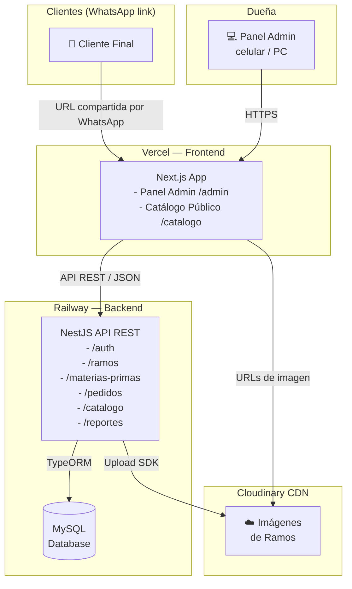
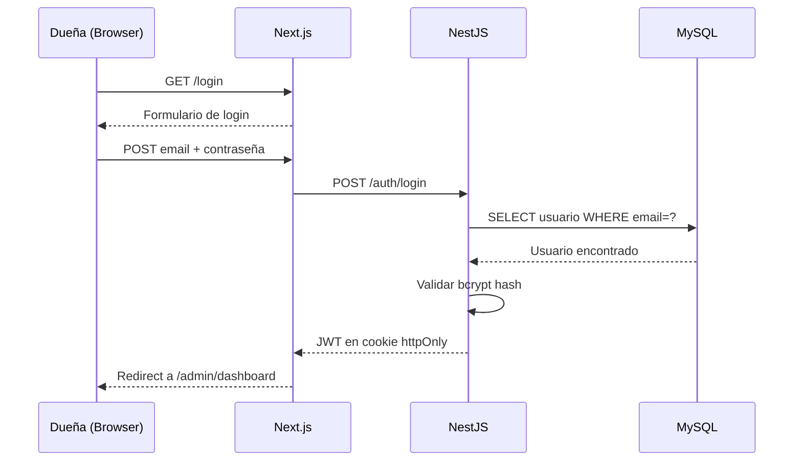
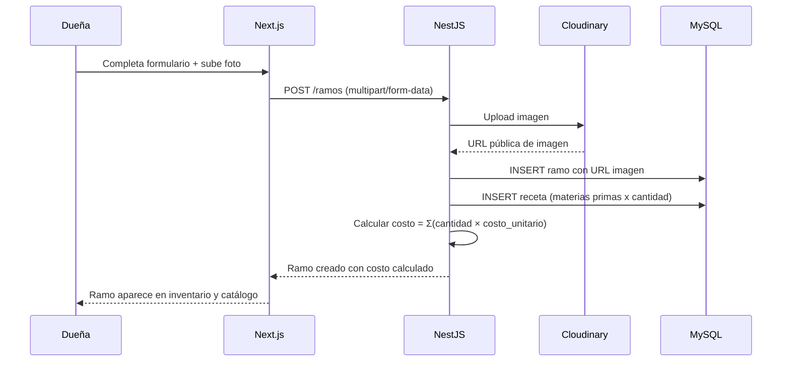
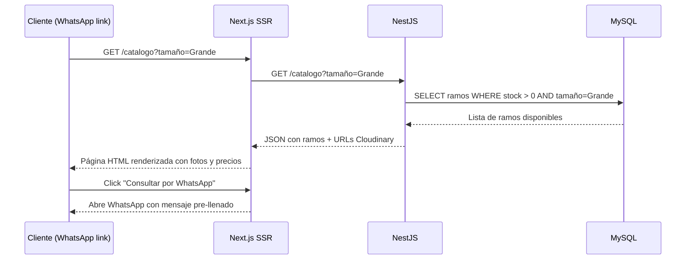
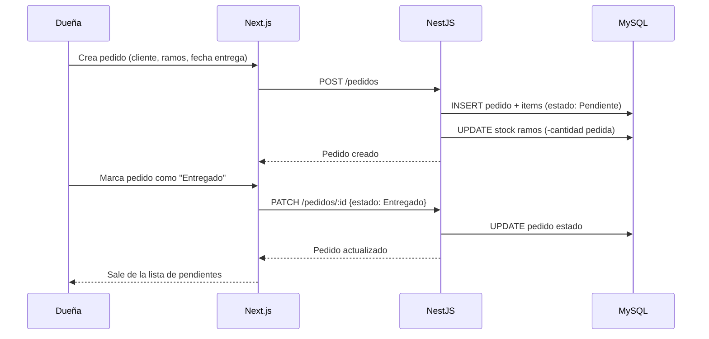
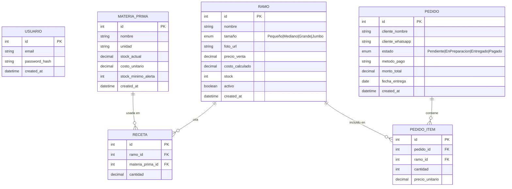

# Architecture — EternaFlor

> Versión: 1.0 | Fecha: 2026-05-05 | Basado en: PRD EternaFlor MVP

---

## 1. Resumen Ejecutivo

EternaFlor es una aplicación web responsive diseñada para una vendedora independiente de ramos florales de plástico en Lima, Perú. El sistema resuelve la gestión manual del negocio (cuadernos, WhatsApp, memoria) mediante cuatro módulos principales: inventario de ramos, control de materias primas, gestión de pedidos y catálogo digital público compartible.

**Principios arquitectónicos guía:**

- **Simplicidad operativa:** Una sola usuaria administradora. Sin complejidad de roles, multi-tenancy ni microservicios.
- **Costo cero:** Toda la infraestructura se sostiene en tiers gratuitos de servicios cloud.
- **Mobile-first:** La dueña opera principalmente desde su celular; el catálogo debe cargar rápido en conexiones móviles estándar.
- **Separación clara frontend/backend:** Next.js en Vercel consume una API REST construida en NestJS desplegada en Railway.
- **Datos propios, siempre exportables:** La dueña puede descargar sus datos en CSV en cualquier momento.

---

## 2. Contexto y Restricciones

**Escala objetivo:**
- 1 usuario administrador (la dueña)
- Hasta 100 ramos en catálogo
- Hasta 50 pedidos por mes
- Tráfico público al catálogo: esporádico y de bajo volumen (familia, clientes por WhatsApp)

**Restricciones de negocio:**
- Presupuesto de infraestructura: $0 USD/mes (solo tiers gratuitos)
- Moneda única: Soles peruanos (PEN)
- Idioma único: español
- Operación individual: sin empleados ni colaboradores con acceso al sistema
- Tipos de producto fijos: ramos en 4 tamaños (Pequeño, Mediano, Grande, Jumbo)

**Restricciones técnicas:**
- Frontend desplegado en Vercel (free tier)
- Backend + MySQL desplegados en Railway (free tier: 500 horas/mes, ~512 MB RAM, 1 GB MySQL)
- Almacenamiento de imágenes en Cloudinary (free tier: 25 créditos/mes, ~25 GB de transformaciones)
- Sin servidor dedicado ni VPS propio
- Sin CI/CD automatizado en MVP; despliegue manual vía push a rama principal

**Compliance / regulatorio:**
- No aplican regulaciones de datos sensibles (no se manejan datos de salud, financieros de terceros ni datos sujetos a GDPR)
- Los datos de clientes capturados son mínimos: nombre y número de WhatsApp, usados únicamente para coordinar entregas

---

## 3. Decisiones Arquitectónicas (ADRs)

### ADR-001: Arquitectura cliente-servidor desacoplada (Next.js + NestJS)

- **Decisión:** Separar el frontend (Next.js en Vercel) del backend (NestJS en Railway) en repositorios y despliegues independientes. La comunicación es exclusivamente mediante API REST JSON.
- **Contexto:** La aplicación tiene dos audiencias con necesidades distintas: la dueña (panel de administración privado) y los clientes (catálogo público). Un backend separado permite servir ambas desde la misma API, reutilizando lógica de negocio.
- **Consecuencias:** Mayor claridad de responsabilidades. Se requiere manejo de CORS. El catálogo público puede hacer SSR/SSG en Next.js para mejor rendimiento sin depender del backend para cada visita.

---

### ADR-002: Base de datos MySQL en Railway

- **Decisión:** Usar MySQL como base de datos relacional, gestionada en el tier gratuito de Railway.
- **Contexto:** El modelo de datos de EternaFlor es inherentemente relacional (ramos → recetas → materias primas; pedidos → items → ramos). MySQL es sólido para este patrón y Railway ofrece instancias gratuitas sin fricción de configuración.
- **Consecuencias:** Límite de 1 GB de almacenamiento en tier gratuito (suficiente dado el volumen esperado). Se usa Prisma como ORM dentro de NestJS para tipado fuerte, schema declarativo y migraciones controladas con `prisma migrate`.

---

### ADR-003: Almacenamiento de imágenes en Cloudinary

- **Decisión:** Las fotos de ramos se suben al backend, que las reenvía a Cloudinary. La URL pública de Cloudinary se almacena en la base de datos.
- **Contexto:** Railway no tiene almacenamiento de archivos persistente entre reinicios. Cloudinary ofrece un tier gratuito generoso, CDN global, y transformaciones automáticas (redimensionado, compresión) que mejoran la velocidad del catálogo en móviles.
- **Consecuencias:** Dependencia de un servicio externo para imágenes. Si Cloudinary cambia su tier gratuito, se necesita migración. A cambio, las imágenes se sirven desde CDN sin consumir ancho de banda del servidor.

---

### ADR-004: Autenticación con JWT en cookie httpOnly

- **Decisión:** El panel de administración está protegido por email y contraseña. El backend emite un JWT almacenado en una cookie httpOnly con SameSite=Strict.
- **Contexto:** Un solo usuario administrador. No se necesita OAuth, SSO ni gestión de roles. La cookie httpOnly protege el token de ataques XSS en el frontend.
- **Consecuencias:** Sin refresh token en MVP (la sesión expira y la dueña vuelve a iniciar sesión). Simple de implementar y suficiente para el caso de uso.

---

### ADR-005: Catálogo público con SSR en Next.js

- **Decisión:** La ruta pública del catálogo (`/catalogo`) usa Server-Side Rendering (SSR) en Next.js, consultando directamente la API del backend en cada visita.
- **Contexto:** El catálogo debe cargar en menos de 3 segundos en móvil y estar siempre actualizado (ramos con stock 0 deben desaparecer de inmediato). SSR garantiza datos frescos sin lógica de caché compleja en el MVP.
- **Consecuencias:** Cada visita al catálogo genera una request al backend. Con el volumen esperado (tráfico esporádico), esto no representa un problema. Si el tráfico crece, se puede agregar ISR (Incremental Static Regeneration) sin cambios de arquitectura.

---

### ADR-006: Exportación de datos en CSV como estrategia de backup

- **Decisión:** El panel de administración incluye una opción para exportar todos los datos (ramos, materias primas, pedidos) en formato CSV descargable.
- **Contexto:** Railway free tier puede reiniciarse o los datos pueden perderse si el servicio se suspende por inactividad. Sin presupuesto para backups automáticos, la exportación manual es la mitigación principal.
- **Consecuencias:** La dueña debe recordar exportar periódicamente. En v2 se puede automatizar con un cron job que envíe el CSV por email.

---

## 4. Diagrama de Alto Nivel

---

## 5. Componentes del Sistema

### 5.1 Frontend — Next.js (Vercel)

| Atributo | Detalle |
|---|---|
| **Tecnología** | Next.js 14+ (App Router), TypeScript, TailwindCSS |
| **Responsabilidad** | Renderizar el panel de administración y el catálogo público |
| **Rutas principales** | `/login`, `/admin/*` (protegidas), `/catalogo` (pública) |
| **Interfaces** | Consume API REST del backend vía `fetch` / Axios |
| **Deployment** | Vercel (free tier), auto-deploy desde rama `main` |

**Módulos de UI:**
- `InventarioRamos` — CRUD de ramos con foto y receta de materias primas
- `MateriasPrimas` — CRUD de insumos con alertas de stock bajo
- `Pedidos` — Creación y seguimiento de pedidos con cambio de estado
- `Catalogo` — Vista pública filtrable por tamaño (SSR)
- `Reportes` — Dashboard de ingresos, costos y margen

---

### 5.2 Backend — NestJS (Railway)

| Atributo | Detalle |
|---|---|
| **Tecnología** | NestJS, TypeScript, Prisma ORM, MySQL2 |
| **Responsabilidad** | Lógica de negocio, validaciones, acceso a datos, autenticación |
| **Patrón** | Modular por dominio (módulo por cada entidad principal) |
| **Interfaces** | API REST JSON; comunicación con Cloudinary SDK y MySQL |
| **Deployment** | Railway (free tier), auto-deploy desde rama `main` |

**Módulos NestJS:**
- `AuthModule` — Login, JWT, guard de rutas protegidas
- `RamosModule` — CRUD ramos, cálculo automático de costo por receta
- `MateriasPrimasModule` — CRUD insumos, descuento automático de stock
- `PedidosModule` — CRUD pedidos, cambio de estado, historial
- `CatalogoModule` — Endpoint público de ramos disponibles (stock > 0)
- `ReportesModule` — Agregaciones de ingresos, costos y márgenes
- `UploadModule` — Recepción y reenvío de imágenes a Cloudinary

---

### 5.3 Base de datos — MySQL (Railway)

| Atributo | Detalle |
|---|---|
| **Tecnología** | MySQL 8, gestionado por Railway |
| **Responsabilidad** | Persistencia de todos los datos del negocio |
| **Acceso** | Solo desde el backend NestJS (no expuesto públicamente) |
| **Límite** | 1 GB de almacenamiento en tier gratuito |

---

### 5.4 Almacenamiento de imágenes — Cloudinary

| Atributo | Detalle |
|---|---|
| **Tecnología** | Cloudinary (tier gratuito) |
| **Responsabilidad** | Almacenar y servir fotos de ramos vía CDN |
| **Integración** | El backend usa el SDK oficial de Cloudinary para Node.js |
| **Límite** | 25 GB de almacenamiento, ~25 créditos/mes de transformaciones |

---

## 6. Flujos Principales

### 6.1 Autenticación de la dueña

---

### 6.2 Registro de un ramo nuevo con foto y receta

---

### 6.3 Cliente visita el catálogo público

---

### 6.4 Registro y cierre de un pedido

---

## 7. Infraestructura y Deployment

### Ambientes

| Ambiente | Frontend | Backend | Base de datos |
|---|---|---|---|
| **Desarrollo** | `localhost:3000` (Next.js dev) | `localhost:3001` (NestJS dev) | MySQL local o Railway dev branch |
| **Producción** | `eternaflor.vercel.app` | `api-eternaflor.railway.app` | MySQL Railway producción |

No se contempla ambiente de staging en el MVP dado el equipo unipersonal y el presupuesto cero.

### Estrategia de CI/CD

- **Frontend:** Push a rama `main` del repositorio frontend → Vercel detecta el cambio y despliega automáticamente (build + deploy en ~2 min).
- **Backend:** Push a rama `main` del repositorio backend → Railway detecta el cambio y redespliega automáticamente (build Docker interno + deploy).
- **Migraciones de base de datos:** Se ejecutan con `prisma migrate deploy` como parte del proceso de arranque del backend en Railway (configurado en el comando de start del `package.json`), garantizando que el esquema esté siempre actualizado antes de que la API acepte tráfico.

### Escalabilidad

Con el volumen esperado (1 usuaria admin, tráfico de catálogo esporádico), el tier gratuito es suficiente. Si el negocio crece:
- Railway free → Railway Starter ($5/mes) para eliminar el límite de horas y agregar más RAM.
- Agregar caché Redis para el catálogo público (ISR en Next.js es la opción sin costo adicional).

---

## 8. Seguridad

### Autenticación y Autorización

- La contraseña de la dueña se almacena con hash bcrypt (salt rounds: 12) en MySQL.
- El backend emite un JWT firmado con `JWT_SECRET` (variable de entorno en Railway) con expiración de 8 horas.
- El JWT viaja exclusivamente en una cookie httpOnly + SameSite=Strict, nunca en localStorage.
- Todas las rutas `/admin/*` del frontend verifican la presencia del JWT antes de renderizar.
- Todas las rutas de la API NestJS (excepto `/auth/login` y `/catalogo`) requieren el guard `JwtAuthGuard`.

### Manejo de Secretos

| Secreto | Dónde vive |
|---|---|
| `JWT_SECRET` | Variable de entorno en Railway |
| `DATABASE_URL` | Variable de entorno en Railway (inyectada por Railway automáticamente) |
| `CLOUDINARY_CLOUD_NAME` | Variable de entorno en Railway |
| `CLOUDINARY_API_KEY` | Variable de entorno en Railway |
| `CLOUDINARY_API_SECRET` | Variable de entorno en Railway |
| `NEXT_PUBLIC_API_URL` | Variable de entorno en Vercel |

Ningún secreto se commitea al repositorio. Se usa `.env.example` como referencia sin valores reales.

### Superficie de Ataque

- **Catálogo público:** Solo lectura, sin autenticación. No acepta parámetros que modifiquen datos.
- **CORS:** El backend solo acepta requests desde el dominio de Vercel (configurado en NestJS `CorsModule`).
- **Rate limiting:** NestJS `ThrottlerModule` limita el endpoint `/auth/login` a 5 intentos por minuto para mitigar fuerza bruta.
- **Validación de inputs:** Todos los DTOs de NestJS usan `class-validator` para sanitizar y validar datos entrantes.
- **Subida de archivos:** Solo se aceptan archivos con MIME type `image/jpeg`, `image/png` o `image/webp`, con tamaño máximo de 5 MB.

---

## 9. Datos

### Modelo de Datos de Alto Nivel

### Estrategia de Persistencia

- **ORM:** Prisma con migraciones versionadas (`prisma migrate dev` en desarrollo, `prisma migrate deploy` en producción). El schema se define en `schema.prisma` como fuente única de verdad. Nunca se modifica la base de datos directamente en producción sin una migración.
- **Cálculo de costo:** El campo `costo_calculado` en `RAMO` se recalcula en el backend cada vez que se modifica la receta o el costo unitario de una materia prima relacionada.
- **Descuento de stock:** Al registrar la fabricación de un ramo, el backend descuenta automáticamente las materias primas según la receta en una transacción atómica.

### Backups y Retención

- **Backup manual:** El panel de administración expone un endpoint `GET /admin/exportar` que genera y descarga un archivo ZIP con CSVs de todas las entidades.
- **Frecuencia recomendada:** Semanalmente (la dueña lo hace manualmente).
- **Retención de imágenes:** Las imágenes en Cloudinary no se eliminan automáticamente; quedan disponibles indefinidamente dentro del límite del tier gratuito.
- **Sin backup automático en MVP:** Se contempla para v2 mediante un cron job que envíe el CSV por email.

---

## 10. Observabilidad

### Logging

- **Backend (NestJS):** Logger nativo de NestJS con niveles `log`, `warn`, `error`. En producción los logs se visualizan en el dashboard de Railway en tiempo real.
- **Eventos críticos logueados:** Login exitoso/fallido, creación/modificación de pedidos, errores de subida a Cloudinary, errores de base de datos.
- **No se almacenan logs en base de datos** en el MVP (Railway los retiene ~7 días en su dashboard).

### Métricas

- **Vercel Analytics:** Habilitado por defecto en Vercel free tier. Provee métricas de visitas al catálogo público (page views, país, dispositivo) sin configuración adicional.
- **Railway Metrics:** Dashboard de Railway muestra CPU, RAM y requests del backend en tiempo real.

### Alertas

- **Stock bajo de ramos:** Calculado en frontend al consultar el inventario; se muestra un badge visual cuando `stock ≤ 2`.
- **Stock bajo de materias primas:** Calculado contra `stock_minimo_alerta`; visible en la lista de materias primas.
- **No hay alertas por email ni push en el MVP.** La dueña revisa el panel para detectarlos.

---

## 11. Riesgos y Mitigaciones

| Riesgo | Probabilidad | Impacto | Mitigación |
|---|---|---|---|
| Railway suspende el servicio por inactividad (free tier) | Media | Alto | Configurar un ping periódico (ej. UptimeRobot gratuito) para mantener el servicio activo |
| Pérdida de datos si no se realiza exportación manual | Alta | Alto | Recordatorio visual en el panel ("Última exportación: hace X días") |
| Fotos de baja calidad degradan el catálogo | Alta | Medio | Cloudinary aplica compresión automática; documentar recomendaciones de foto para la dueña |
| Costo calculado incorrecto si recetas no se actualizan | Media | Medio | Mostrar alerta cuando el costo unitario de una materia prima cambia y hay ramos afectados |
| Resistencia a adopción por curva de aprendizaje | Media | Alto | Diseño mobile-first, flujos de máximo 3 pasos, textos grandes y claros |
| Límite de almacenamiento MySQL (1 GB) superado | Baja | Medio | Con el volumen esperado (< 100 ramos, < 50 pedidos/mes) no se alcanza en años; monitorear en Railway |
| Cambio de tier gratuito en Railway o Cloudinary | Baja | Alto | Documentar proceso de migración a alternativas (PlanetScale, Supabase para DB; Uploadthing para imágenes) |

---

## 12. Hoja de Ruta Técnica (Fases)

### Fase 1 — Base del sistema (Semanas 1–3)
- Setup de repositorios (frontend Next.js, backend NestJS)
- Configuración de MySQL en Railway + esquema inicial + migraciones
- Módulo de autenticación (login, JWT, guard)
- CRUD de Materias Primas
- CRUD de Ramos con subida de foto a Cloudinary
- CRUD de Recetas con cálculo automático de costo

### Fase 2 — Pedidos y Catálogo (Semanas 4–5)
- Módulo de Pedidos (creación, estados, historial)
- Descuento automático de stock de materias primas al fabricar
- Catálogo público SSR con filtros por tamaño
- Botón de WhatsApp en catálogo con mensaje pre-llenado
- Alertas de stock bajo (ramos y materias primas)

### Fase 3 — Reportes y Exportación (Semana 6)
- Panel de reportes (ingresos, costos, márgenes por período y tamaño)
- Endpoint de exportación CSV (backup manual)
- Pulido de UI mobile-first (TailwindCSS, tipografías grandes, flujos simplificados)

### Fase 4 — QA y Lanzamiento (Semana 7)
- Pruebas end-to-end de los escenarios definidos en los criterios de aceptación del PRD
- Configuración de UptimeRobot para mantener Railway activo
- Entrega y capacitación a la dueña
- Documentación de uso (guía rápida en PDF o video)

---

## Apéndice — Asunciones Consolidadas

| # | Categoría | Decisión |
|---|---|---|
| 1 | Escala esperada | 1 usuario admin, hasta 100 ramos, hasta 50 pedidos/mes |
| 2 | Modelo de deployment | Vercel (frontend) + Railway (backend + MySQL); sin servidor propio |
| 3 | Stack tecnológico | **Next.js (React) + NestJS + MySQL + Cloudinary** ✏️ *revisada* |
| 4 | Autenticación | Email + contraseña, JWT en cookie httpOnly, sesión de 8 horas |
| 5 | Presupuesto de infraestructura | **$0 USD/mes — solo tiers gratuitos (Vercel, Railway, Cloudinary)** ✏️ *revisada* |
| 6 | Equipo de desarrollo | Desarrollo individual, sin CI/CD automatizado (Vercel/Railway auto-deploy desde main) |
| 7 | Backups | Exportación manual en CSV desde el panel; sin backup automático en MVP |
| 8 | Compliance | Sin regulaciones aplicables; datos de clientes limitados a nombre y WhatsApp |
| 9 | Moneda y formato | Soles peruanos (PEN), 2 decimales, sin soporte multi-moneda |
| 10 | Almacenamiento de imágenes | Cloudinary, referenciado por URL, máximo 5 MB por imagen |
| 11 | Catálogo público | URL fija compartible, sin autenticación, SSR en Next.js |
| 12 | Disponibilidad | Best-effort (~99%), sin SLA formal; UptimeRobot para mantener Railway activo |
| 13 | Internacionalización | Solo español, sin i18n |
| 14 | Versionado de API | Sin versionado formal en MVP |
