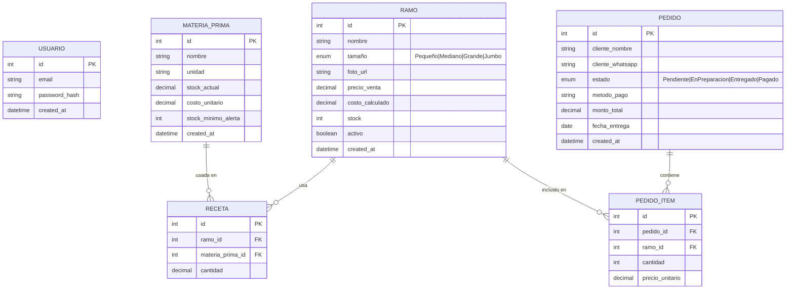

# 9. Datos

## Modelo de Datos de Alto Nivel

## Estrategia de Persistencia

- **ORM:** Prisma con migraciones versionadas (`prisma migrate dev` en desarrollo, `prisma migrate deploy` en producción). El schema se define en `schema.prisma` como fuente única de verdad. Nunca se modifica la base de datos directamente en producción sin una migración.
- **Cálculo de costo:** El campo `costo_calculado` en `RAMO` se recalcula en el backend cada vez que se modifica la receta o el costo unitario de una materia prima relacionada.
- **Descuento de stock:** Al registrar la fabricación de un ramo, el backend descuenta automáticamente las materias primas según la receta en una transacción atómica.

## Backups y Retención

- **Backup manual:** El panel de administración expone un endpoint `GET /admin/exportar` que genera y descarga un archivo ZIP con CSVs de todas las entidades.
- **Frecuencia recomendada:** Semanalmente (la dueña lo hace manualmente).
- **Retención de imágenes:** Las imágenes en Cloudinary no se eliminan automáticamente; quedan disponibles indefinidamente dentro del límite del tier gratuito.
- **Sin backup automático en MVP:** Se contempla para v2 mediante un cron job que envíe el CSV por email.
