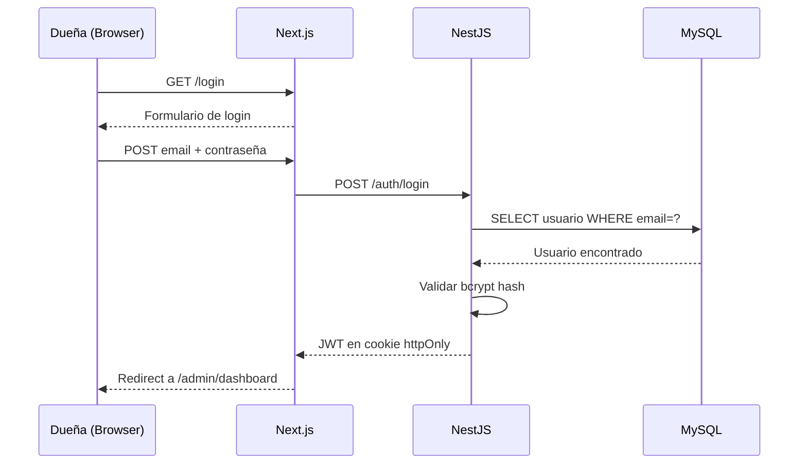
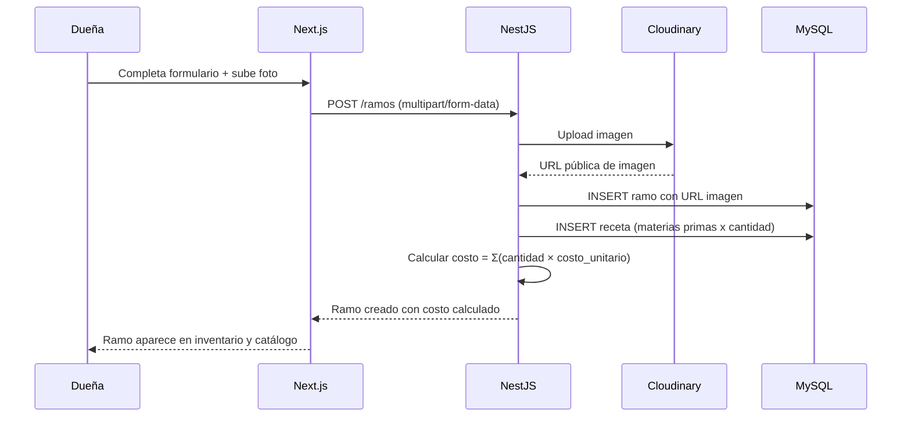
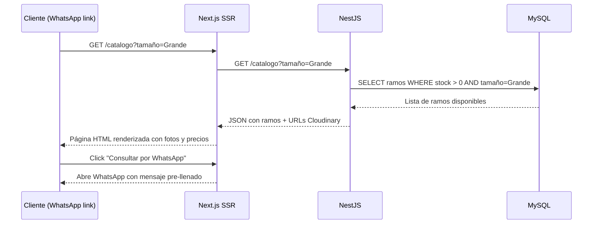
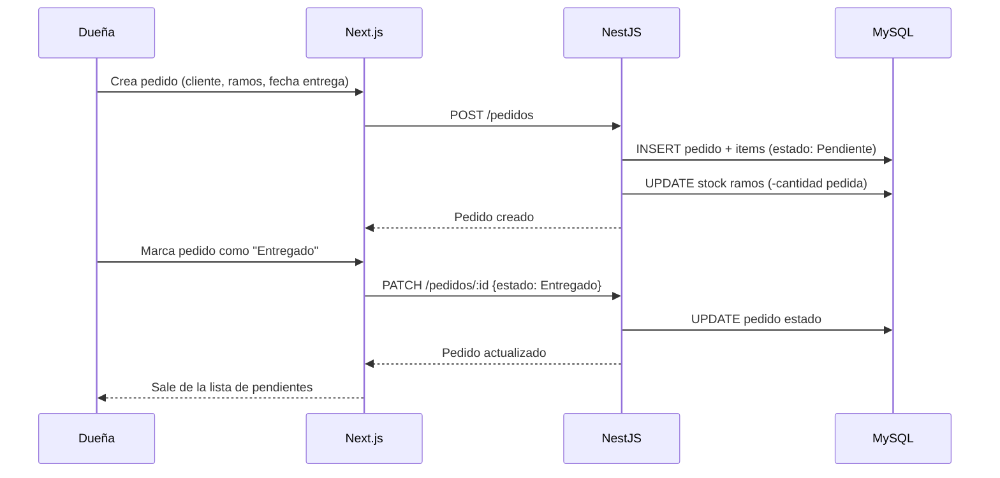

# 6. Flujos Principales

## 6.1 Autenticación de la dueña

---

## 6.2 Registro de un ramo nuevo con foto y receta

---

## 6.3 Cliente visita el catálogo público

---

## 6.4 Registro y cierre de un pedido

